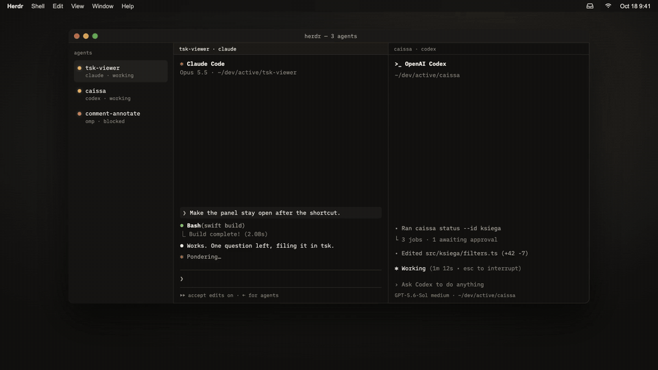

# TskViewer

[English](README.md)



Film (22 s, po angielsku) w [pełnej jakości MP4](docs/demo.mp4).

Natywna aplikacja macOS 15+ w pasku menu, bez ikony w Docku. Widok „Czeka na mnie” zbiera zadania `blocked` i `review` ze wszystkich projektów i biurka, grupując je według projektu. Ikona pokazuje ich liczbę (przy zerze sam symbol). Przełącznik „Pozostałe zadania” udostępnia inne żywe statusy tylko do odczytu. Szczegóły zawierają notatki z podstawowym markdownem i kroki tylko do odczytu.

Gdy agent podpisze notatki linią `Herdr: <panel>`, odpowiedź domyślnie trafia właśnie do niego, o ile jest osiągalny. Prawy klik na ikonie → „Nazwij agentów” pokazuje wszystkich agentów Herdr z tytułami terminali i pozwala nazwać ich naraz.

SwiftPM bez zewnętrznych zależności: `TskCore` zawiera klienta CLI i logikę, `TskViewer` — interfejs SwiftUI/AppKit.

## Budowanie i uruchamianie

Wymagane macOS, narzędzia Swift/Xcode oraz lokalne `tsk` (kontrakt CLI 0.11.6).

```sh
swift build
swift test
scripts/build-app.sh
open build/TskViewer.app
```

Testy `TskCore` używają atrap wykonawcy CLI, nie prawdziwej tablicy. Skrypt można wywołać z dowolnego katalogu: buduje release, zastępuje poprzedni `build/TskViewer.app` i podpisuje pakiet ad hoc. `.build/` i `build/` są ignorowane przez git.

To lokalny pakiet bez notaryzacji i podpisu Developer ID. Podpis ad hoc nie zapewnia zaufania Gatekeepera; system może wymagać ręcznego dopuszczenia aplikacji w ustawieniach prywatności i ochrony. Nie wyłączaj ochrony systemu. Powiadomienia są włączane tylko przy uruchomieniu pakietu `.app`, nie samego pliku wykonywalnego SwiftPM.

## Plugin Herdr

Repozytorium jest pluginem [Herdr](https://herdr.dev/plugins/) (`herdr-plugin.toml`). Instalacja buduje aplikację (`scripts/build-app.sh`, wymaga Swift/Xcode), a każdy start serwera Herdr uruchamia ją przez `scripts/herdr-start.sh`, o ile jeszcze nie działa. Skrypt kopiuje `.app` do katalogu stanu pluginu i przekazuje aplikacji ścieżki `herdr` (`HERDR_PATH`) i `tsk` (`TSK_PATH`) z PATH. Akcja „Start TskViewer” robi to samo ręcznie.

```sh
herdr plugin install Nikospy/tsk-viewer
# albo lokalnie, po scripts/build-app.sh:
herdr plugin link .
```

## Ustawienia i obsługa

Przycisk koła zębatego otwiera ustawienia ścieżki `tsk` i interwału odpytywania. Kolejność wyboru programu: niepuste ustawienie w aplikacji → zmienna środowiskowa `TSK_PATH` → `/opt/homebrew/bin/tsk`. Przykład uruchomienia z własną ścieżką (najpierw zakończ działającą instancję):

```sh
TSK_PATH=/pełna/ścieżka/tsk build/TskViewer.app/Contents/MacOS/TskViewer
```

Aplikacja otwarta z Findera nie musi dziedziczyć środowiska terminala; dla niej najprościej zapisać ścieżkę w ustawieniach. Puste pole przywraca wybór przez `TSK_PATH` lub domyślną ścieżkę. **Zmiana programu usuwa lokalne wersje robocze odpowiedzi i zamyka szczegóły.** Ustawienia są zachowywane między uruchomieniami.

Ustawienie „język” (systemowy, English, polski) zmienia interfejs od razu. Wybiera też język umowy z agentami: prefiks odpowiedzi w notatkach (`Odp:` albo `Reply:`) i wiadomości `tsk:`. Systemowy oznacza polski tylko wtedy, gdy polski jest pierwszym językiem systemu.

Odpytywanie działa w tle, domyślnie co 10 s (ustawienia: 2–3600 s). Ręczne odświeżanie: przycisk strzałki lub Cmd+R. Esc zamyka panel; Cmd+Return wysyła odpowiedź z otwartego edytora. Menu wielokropka zawiera „Zakończ TskViewer”.

## Decyzje i odpowiedzi

| Status | Przycisk | Skutek |
| --- | --- | --- |
| `blocked` | Zgoda | → `ready` |
| `blocked` | Odpowiedz | dopisanie `Odp: …`, następnie → `ready` |
| `review` | Akceptuj | → `done` |
| `review` | Odeślij z uwagami | dopisanie `Odp: …`, następnie → `ready` |

Inne statusy nie mają akcji zmieniających stan. Aplikacja nigdy nie ustawia `started`, `open`, `blocked` ani `review`; nie zmienia kroków, nie archiwizuje ani nie usuwa zadań.

Odpowiedź nie może być pusta po obcięciu białych znaków. Jej nowe linie są zamieniane na spacje, a jedna linia `Odp: <tekst>` trafia na koniec notatek; dotychczasowa treść pozostaje bez zmian. CLI jest uruchamiane przez `Process` z tablicą argumentów, bez powłoki; notatki są przekazywane jako jeden argument `--notes=…`, także gdy tekst zaczyna się od `-`.

Zapis odpowiedzi przebiega w kolejności **`edit` → potwierdzenie odczytem → świeży odczyt warunków → `status`**. Odmowa lub błąd wywołania `edit` nie zmienia statusu i zachowuje tekst. Gdy odpowiedź jest zapisana, lecz status pozostaje bez zmian, panel pokazuje „Odpowiedź zapisana, status bez zmian” i przycisk „Ponów zmianę statusu”. Ponowienie sprawdza aktualne warunki i zmienia wyłącznie status — nie dopisuje odpowiedzi drugi raz.

Po zapisie z kodem 0 stan jest potwierdzany odczytem. Kod 3 oznacza nieznany skutek: aplikacja odczytuje zadanie (także z `--done`, jeśli zniknęło z żywych), zamiast ponawiać w ciemno. Porównuje notatki lub status z pierwotnymi i oczekiwanymi; niejednoznaczny wynik wymaga sprawdzenia świeżego stanu przez użytkownika. Błędy odczytu są wyświetlane w panelu.

### Współbieżne zmiany — pozostające ryzyko

Bezpośrednio przed `edit` i przed zmianą statusu aplikacja świeżo odczytuje zadanie. Rozbieżność notatek lub statusu zatrzymuje zapis, pokazuje świeży stan, zachowuje wpisany tekst i wymaga ponownego potwierdzenia.

**To nie jest zapis atomowy ani pełna ochrona przed nadpisaniem.** `tsk edit --notes` nadpisuje notatki w całości. Agent może zmienić je w oknie między ostatnim odczytem a zapisem aplikacji; wtedy jego zmiana zostanie utracona. Odczyt po zapisie nie eliminuje tego ryzyka.

## Wiadomości do agentów

Po decyzji aplikacja wkleja agentowi w Herdr jedną linię zaczynającą się od `tsk:`. Instrukcje agenta (CLAUDE.md, AGENTS.md) powinny mówić, co z nią zrobić:

| Wiadomość `tsk:` | Co robi agent |
| --- | --- |
| `zgoda, status ready` | przyjmuje rekomendację z notatek, `tsk status T# start`, wykonuje |
| `odpowiedź dopisana do notatek (ostatnia linia Odp:)` | `tsk list T# --json`, działa według ostatniej linii `Odp:` |
| `uwagi do poprawki w notatkach (ostatnia linia Odp:)` | poprawia według `Odp:`, potem znowu `review` |
| `zaakceptowane, status done` | zadanie zamknięte; status zostaje |
| `gracz prosi o omówienie i realizację: …` | czyta zadania i proponuje plan, zanim zmieni status |

„gracz” to użytkownik. Wersję angielską opisuje [README.md](README.md#messages-to-agents).

## Powiadomienia

Aplikacja prosi system o zgodę na powiadomienia. Odmowa nie blokuje pracy. Pierwszy udany odczyt po starcie jest cichy; kolejne zgłaszają przejścia do `blocked` lub `review`, także pojawienie się nowego zadania w takim statusie. Brak zmiany nie powiela powiadomień, a błąd odczytu nie zeruje porównania. Powiadomienie zawiera numer zadania, tytuł, projekt i status; kliknięcie otwiera panel z tym zadaniem.

## Integracja z agentami poza repo

Skrypt `tsk-pilnuj.sh` w dotfiles użytkownika wymaga osobnej poprawki **poza tym repo**: powinien wybierać **ostatnią** linię `Odp:`, a nie pierwszą (`grep -m1 '^Odp:'`). Aplikacja dopisuje kolejne odpowiedzi na końcu notatek, więc odczytywanie pierwszej może przekazać agentowi starą odpowiedź. Ten pakiet nie modyfikuje dotfiles.

## Zakres weryfikacji

Wygląd, ikona w pasku menu i powiadomienia **nie były weryfikowane automatycznie**. Wymagają ręcznego sprawdzenia działającej `.app`, w tym uprawnień powiadomień oraz trybu jasnego i ciemnego. Budowanie, testy rdzenia, składanie pakietu, poprawność plist i podpis ad hoc można sprawdzić lokalnymi poleceniami opisanymi wyżej oraz `plutil -lint Support/Info.plist` i `codesign --verify build/TskViewer.app`.
